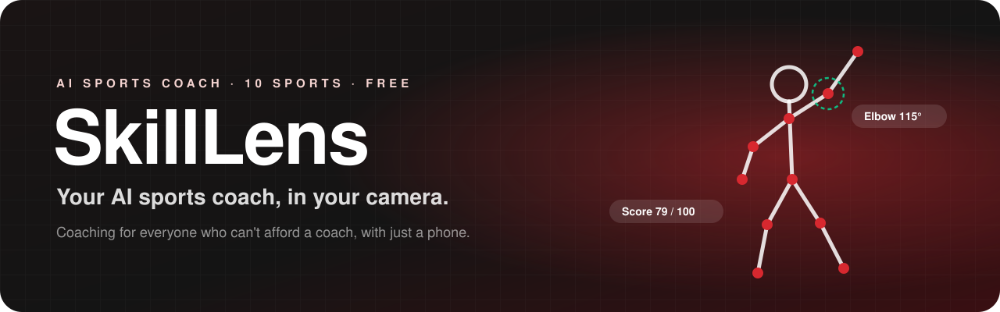
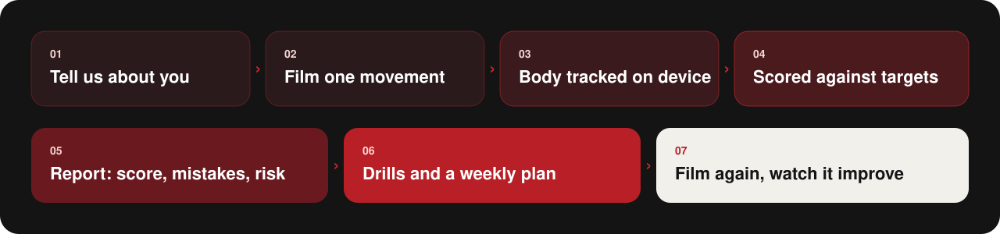
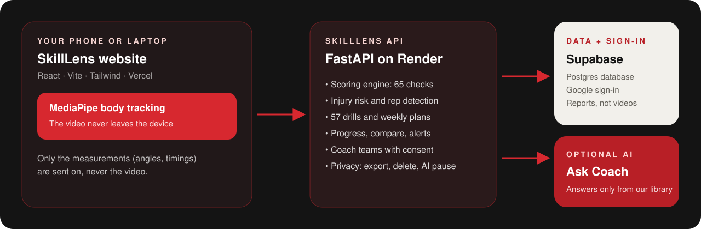

<p align="center">
  
</p>

<h1 align="center">SkillLens</h1>

<p align="center"><b>Turning a phone camera into a sports coach.</b></p>

<p align="center">
SkillLens watches a short video of your technique, measures how your body moves, and tells you in plain English
what is right, what is wrong, how risky it is for injury, and exactly which drills fix it. It is built for players who
cannot afford a coach or an academy, but still want to know if they are doing it right.
</p>

<p align="center">
  <a href="https://skill-lens-nu.vercel.app"></a>
  <a href="https://skill-lens-nu.vercel.app/login"></a>
</p>

<p align="center">
  
  
  
  
  
  
</p>

<p align="center">
  <a href="#what-is-skilllens">Overview</a> ·
  <a href="#the-journey">Journey</a> ·
  <a href="#what-it-can-do">Capabilities</a> ·
  <a href="#how-it-is-built">Architecture</a> ·
  <a href="#privacy-and-safety">Privacy</a> ·
  <a href="#run-it-yourself">Run it</a>
</p>

---

## At a Glance

<table>
  <tr>
    <td width="50%" valign="top"><sub><b>THE PRODUCT</b></sub><br>An AI sports coach that runs in the browser. Film one movement, get a scored report, drills and a weekly plan.</td>
    <td width="50%" valign="top"><sub><b>THE PROBLEM</b></sub><br>Good coaching is expensive. Most young players never get anyone to check their technique, so mistakes and injuries go unnoticed.</td>
  </tr>
  <tr>
    <td valign="top"><sub><b>THE APPROACH</b></sub><br>On-device body tracking, 65 measured checks across 10 sports, a deterministic scoring engine and a library of 57 drills, all explained in plain English.</td>
    <td valign="top"><sub><b>THE STACK</b></sub><br>React · Vite · Tailwind CSS · MediaPipe · Python · FastAPI · SQLAlchemy · Supabase (Postgres + Google sign-in) · Groq</td>
  </tr>
  <tr>
    <td valign="top"><sub><b>WHERE IT CAME FROM</b></sub><br>Started as a prototype in a sports hackathon, which our team won. Since rebuilt into a complete app as an independent personal project.</td>
    <td valign="top"><sub><b>LIVE</b></sub><br><a href="https://skill-lens-nu.vercel.app">skill-lens-nu.vercel.app</a><br>Use <b>Take the tour</b> to see a full example account without signing in.</td>
  </tr>
</table>

> [!NOTE]
> SkillLens gives coaching guidance, not medical advice. Target ranges are drawn from published coaching material and are
> still waiting for sign-off by a qualified coach, and every report says so.

<details>
<summary><b>Contents</b></summary>

- [What is SkillLens](#what-is-skilllens)
- [The journey](#the-journey)
- [What it can do](#what-it-can-do)
- [Sports covered](#sports-covered)
- [How a video becomes a report](#how-a-video-becomes-a-report)
- [How it is built](#how-it-is-built)
- [Privacy and safety](#privacy-and-safety)
- [Run it yourself](#run-it-yourself)
- [Project status](#project-status)

</details>

---

## What is SkillLens

SkillLens is a coach in your pocket. You record a short clip of one movement: a bowling action, a jump shot, a smash, a squat.
SkillLens tracks your joints frame by frame, measures angles, timing, balance and speed, compares them with target ranges
for that movement, and turns the result into a report anyone can read.

**Why it exists.** A private coach or academy costs more than most families can spend. Players practise for years without
anyone telling them their elbow is too straight or their knee caves in, until it turns into a plateau or an injury.

**Who it is for.** First, players who have no coach: school kids, club players, people training on their own with a phone.
Second, coaches and academies who want to track a whole squad between sessions.

**How it differs from a generic fitness app.**

| A typical fitness or video app | SkillLens |
|---|---|
| Counts reps or shows your video back to you | Measures 6 to 8 specific checks for each movement and scores each one |
| "Good job!" or a number with no meaning | Says which way to change, by how much, and why it matters |
| One score for everyone | Fits advice to your age, level, goal and any pain you report |
| Ends with the result | Gives drills for every fault, a weekly plan, and tracks progress over time |
| Uploads your video to a server | Tracks your body on your own device; the video never leaves it |

---

## The Journey

Seven steps take a player from first visit to visible improvement.

<p align="center">
  
</p>

| Step | | What happens |
|---|---|---|
| 01 | **Tell us about you** | A short setup: sport, level, training days, goal, height and weight, any pain or past injuries. Every question says why it is asked. |
| 02 | **Film one movement** | Clear filming guidance for each sport: camera angle, distance, how many reps. Record live or upload a clip. |
| 03 | **Body tracked on device** | MediaPipe finds 33 body points in every frame, right in the browser. Each rep is detected and measured on its own. |
| 04 | **Scored against targets** | A rules-based engine scores every check from 0 to 100. Same video, same score, every time. |
| 05 | **The report** | Overall score, grade, injury risk, scores by body area, and each fault explained in one sentence a player understands. |
| 06 | **Drills and a weekly plan** | Every fault links to drills that fix it. A 7-day plan is built from the report and the player's own training days. |
| 07 | **Film again** | Progress charts, then-vs-now comparison, and alerts when a player is improving, stuck, or slipping. |

---

## What It Can Do

<table>
  <tr>
    <td width="33%" valign="top"><b>🎯 Technique report</b><br><sub>Score out of 100, grade, injury risk, scores by area, and every check with its target zone and a plain-English fix.</sub></td>
    <td width="33%" valign="top"><b>🔁 Rep by rep</b><br><sub>Finds each repetition in the clip and scores it, so you can see your best and worst rep.</sub></td>
    <td width="33%" valign="top"><b>🏋️ 57 drills</b><br><sub>Each fault links to drills with sets, time needed and equipment, written for training alone.</sub></td>
  </tr>
  <tr>
    <td valign="top"><b>📅 Weekly plan</b><br><sub>Seven days built from your latest report, your training days, fitness and any sore areas.</sub></td>
    <td valign="top"><b>📈 Progress</b><br><sub>Your score over time, check by check, with "most improved" and "work on next".</sub></td>
    <td valign="top"><b>⚖️ Compare</b><br><sub>Put any two reports side by side: biggest gains, what slipped, every check then vs now.</sub></td>
  </tr>
  <tr>
    <td valign="top"><b>🔔 Smart alerts</b><br><sub>Notices when you are improving, have hit a plateau, or are slipping, and says what to do.</sub></td>
    <td valign="top"><b>👥 Coach teams</b><br><sub>A coach sees the whole squad, weakest first, who is at risk, and can set drills. Players join with a code and agree to share.</sub></td>
    <td valign="top"><b>💬 Ask Coach</b><br><sub>Ask about your technique. Answers come only from SkillLens's own checked library, with sources, or it says it does not know.</sub></td>
  </tr>
  <tr>
    <td valign="top"><b>📄 Save as PDF</b><br><sub>Any report prints cleanly to take to a coach or physio.</sub></td>
    <td valign="top"><b>🔒 Privacy centre</b><br><sub>Download your data, pause AI, or delete your account, with a full log of what happened.</sub></td>
    <td valign="top"><b>🧭 Take the tour</b><br><sub>A full example athlete with six weeks of history, open to anyone, no sign-in.</sub></td>
  </tr>
</table>

---

## Sports Covered

| Sport | Movement | Checks |
|---|---|---|
| 🏏 Cricket | Bowling action | 8 |
| 🏃 Running | Running stride | 8 |
| 🏋️ Gym & Strength | Squat | 7 |
| 🏀 Basketball | Jump shot | 6 |
| ⚽ Football | Instep kick | 6 |
| 🎾 Tennis | Serve | 6 |
| ⚾ Baseball | Pitching | 6 |
| 🏐 Volleyball | Spike | 6 |
| 🏸 Badminton | Overhead smash | 6 |
| 🚴 Cycling | Pedalling (stationary bike) | 6 |
| | **Total** | **65** |

---

## How a Video Becomes a Report

Every movement is measured in **six layers**, so the report covers more than joint angles:

| Layer | What it measures | Example |
|---|---|---|
| 1 | Joint angles | Elbow bend in the loaded position |
| 2 | Body parts against vertical | Trunk lean at release |
| 3 | Distances and positions | Knee over toe in a squat |
| 4 | Left-right balance | One leg doing more work than the other |
| 5 | Timing and order | Hips turning before shoulders |
| 6 | Power and speed | Racket-arm speed at contact |

Each check has a target range and three coaching lines: what to say when it is too low, too high, or just right.
So a player never sees a bare "142°". They see *"Needs about 10° less, a little: your arm is too straight behind you,
so there is no whip left to release."*

The scoring is deterministic: the same video always gives the same score, so a change in score means a real change in
technique. The AI is only used for the optional written summary and for Ask Coach. Scores, risk, drills and plans
work without it.

---

## How It Is Built

<p align="center">
  
</p>

| Part | What it is | Tech |
|---|---|---|
| `frontend/` | The website people use | React 19, Vite, Tailwind CSS v4, React Router, MediaPipe Pose, Recharts |
| `backend/` | The API: scoring, history, plans, teams, privacy | Python, FastAPI, SQLAlchemy, Alembic, pytest |
| Supabase | Database and Google sign-in | Postgres, Supabase Auth |
| Groq | Optional AI for summaries and Ask Coach | Llama 3.3 70B, answers grounded in the SkillLens library |
| Hosting | Website on Vercel, API on Render | Every pull request gets a preview link |

---

## Privacy and Safety

- **Your video stays on your device.** Body tracking runs in the browser. Only the measurements are sent on, never the video.
- **Under-18s are protected.** Younger players are asked for a parent's or guardian's agreement, and advice is adjusted for growing bodies.
- **Sharing is a choice.** A coach sees a player's reports only after the player agrees, and the player can leave at any time.
- **You are in control.** Download everything, pause AI, or delete your account from the Privacy & data page. Deletion is complete after 30 days.
- **No ads, no tracking.** No advertising or analytics cookies.
- **AI is fenced in.** Ask Coach answers only from SkillLens's own library and says so plainly when the library does not cover a question. Your name, email and exact age are never sent to the AI.

Full details are in the Terms of Service and Privacy Policy inside the app.

---

## Run It Yourself

**Backend** (in `backend/`):

```bash
python -m venv .venv
.venv\Scripts\activate        # Windows  (macOS/Linux: source .venv/bin/activate)
pip install -r requirements.txt
copy .env.example .env        # then fill in values
uvicorn app.main:app --reload --port 8000
```

API docs: http://127.0.0.1:8000/docs

**Frontend** (in `frontend/`):

```bash
npm install
copy .env.example .env.local  # then add VITE_SUPABASE_ANON_KEY
npm run dev
```

Open http://localhost:5173

**Tests**

```bash
cd backend && pytest
cd frontend && npm test && npm run build
```

---

## Project Status

- ✅ Body tracking, 65-check scoring engine, injury risk and rep detection
- ✅ Reports, history, progress, compare and smart alerts
- ✅ 57 drills, weekly plans, coach teams and drill assignments
- ✅ Setup questionnaire, Terms and Privacy Policy, privacy centre
- ✅ Take the tour: a full example account with no sign-in
- ⏳ Accuracy check against real recorded clips
- ⏳ Target ranges signed off by a qualified coach
- ⏳ Parent confirmation emails (coming soon)

---

<p align="center">
  <sub>SkillLens is an independent personal project. Built so that good coaching is not only for those who can pay for it.</sub>
</p>
